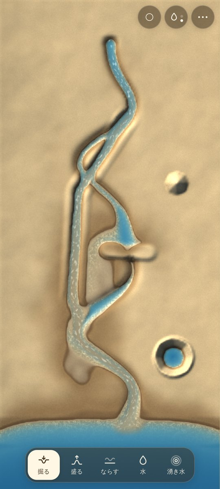

# Suna

砂浜で、砂と水の流れと遊ぶ Android アプリです。

砂を指でなぞって掘ると水が流れこみ、流れは少しずつ砂を削って深くなっていきます。
砂を盛ればせき止められますが、水は横から回りこんだり、砂の中をじわじわ染みて反対側に出てきたりします。
目的やクリアはありません。好きなだけ掘って、盛って、眺めてください。



## あそびかた

画面の上が浜の高いほう、下が海です。上の湧き水から小川が海へ流れています。

下のツールを選んで、砂浜を指でなぞります（複数の指を同時に使えます）。

| ツール | はたらき |
| --- | --- |
| 掘る | 砂をすくいます。すくった砂の半分は両脇に盛り上がります |
| 盛る | 砂を積みます。積んだばかりの砂はゆるく、水に流されやすい砂です |
| ならす | 砂を平らにならして押し固めます。固めた砂は流されにくくなります |
| 水 | 指の下に水を注ぎます |
| 湧き水 | 触れた場所に湧き水を移します |

右上のボタンは左から、筆の太さ（3段階）、湧き水の量（止・ふつう・多め）、メニュー（音のオン／オフ、砂浜のつくりなおし）です。

砂浜の状態は自動で保存され、次に開いたときに続きから遊べます。

### 起きること

- 水は低いほうへ流れ、くぼみに溜まり、いちばん低い縁からあふれます。
- 速い流れは砂を削って運び、流れがゆるむところに落とします。掘った溝は深く広くなり、海には三角州ができます。
- 掘ったり盛ったりした砂はゆるく、すぐ流されます。もとの締まった砂浜は、ゆっくり削られます。
- 急すぎる斜面は崩れます。乾いた砂はなだらかに、湿った砂は切り立って、水に浸かった砂はまた崩れやすくなります。
- 水は砂に染みこみ、砂の中を横へ伝わります。ダムの下流側が濡れてきたら、染み出しのしるしです。
- 海の近くを深く掘ると、砂の中から水が湧いてきます。
- 水が引いた砂は、しばらくすると乾いていきます。

## インストール

Android 8.0 以降の端末で動きます。

1. `suna-release.apk` を端末にダウンロードして開きます。
2. 「提供元不明のアプリ」のインストール許可を求められたら、開いたアプリ（ブラウザやファイルアプリ）に許可を与えます。
3. インストール後、アプリ一覧の「Suna」から起動します。

通信や権限は一切使いません。

## ビルド

JDK 17 以降と Android SDK（`platforms;android-36`、`build-tools;35.0.0`）が必要です。
SDK の場所は環境変数 `ANDROID_HOME` か、`local.properties` の `sdk.dir` で指定します。

```sh
./gradlew assembleRelease
# → app/build/outputs/apk/release/suna-release.apk
```

`app/sideload.keystore` は、どこでビルドしても上書きインストールできるようにするための公開の署名鍵です（パスワードも `app/build.gradle.kts` に書いてあります）。
端末に直接入れて遊ぶためのもので、秘密ではありません。ストアで配布する場合は、別の非公開の鍵で署名してください。

## 開発

ゲーム本体は `app/src/main/assets/www` にある Web ページ（JavaScript + WebGL2）で、Android 側はそれを全画面の WebView に表示するだけの薄い殻です。
そのため、パソコンのブラウザでもそのまま動かせます。

```sh
npm run serve        # http://127.0.0.1:8765/ で遊べます（?seed=7 のように種を指定すると同じ砂浜になります）
npm test             # シミュレーションと保存処理のテスト
```

| 場所 | 内容 |
| --- | --- |
| `app/src/main/assets/www/js/sim.js` | 砂と水のシミュレーション |
| `app/src/main/assets/www/js/terrain.js` | はじめの砂浜の地形 |
| `app/src/main/assets/www/js/render.js` | WebGL2 による描画 |
| `app/src/main/assets/www/js/main.js` | ゲームループ、タッチ入力、UI |
| `app/src/main/assets/www/js/audio.js` | 音（水音・波・砂をこする音を合成） |
| `app/src/main/assets/www/js/store.js` | 砂浜の保存と復元 |
| `app/src/main/java/.../MainActivity.kt` | WebView の殻（全画面表示、同梱ファイルの配信） |
| `tests/` | テスト（`node --test`） |
| `tools/` | 開発用スクリプト（ブラウザ用サーバー、挙動確認用の画像出力、速度計測） |

### シミュレーションのしくみ

砂浜をマス目に区切り、マスごとに「砂の高さ」「水の深さ」「砂の中の水位」「水に浮いている砂の量」「ゆるい砂の厚さ」を持たせています。1秒に120回、次の計算をします。

1. **水の流れ** — 隣り合うマスの水面の高さの差に応じて水を動かします（浅水流の近似）。浅い水ほど底の摩擦で遅くなります。
2. **侵食と堆積** — 流れが速いほど多くの砂を運べます。運べる量に余裕があれば底を削り、超えていれば砂を落とします。浮いた砂は水と一緒に流れます。
3. **崩れ** — 砂が保てる角度（安息角）より急な斜面は、低いほうへ滑ります。
4. **地下水** — 水は砂に染みこみ、砂の中を水位の高いほうから低いほうへ伝わり、砂の表面に達すると湧き出します。
5. **海** — 画面下端は海で、水位が保たれ、ゆっくり上下します。

計算は水のある場所と砂が動いた場所だけで行い、何も起きていない砂には時間を使いません。
